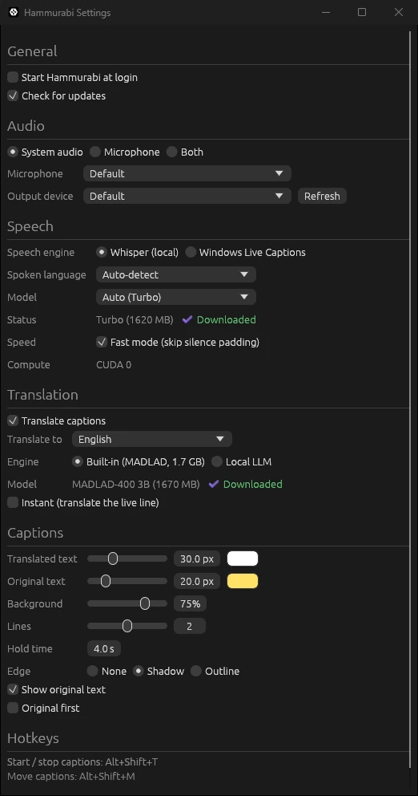

# Hammurabi

**Live captions and translation for anything your computer plays or hears, running entirely on your machine.**

Hammurabi lives in your system tray. Start it, and it writes captions for videos, films, streams, calls, and the person talking to you. Optionally, it translates them into your language. No account, no API key, and no audio leaves your computer.

[](https://hammurabi.menzo.dev)

**[Download the latest release](https://github.com/canmenzo/hammurabi/releases/latest)** for Windows, macOS or Linux. Website: https://hammurabi.menzo.dev

Hammurabi is the desktop sibling of [Babil](https://babil.menzo.dev), the browser extension that does the same for web videos.

## Download

Get the latest build from the [Releases page](https://github.com/canmenzo/hammurabi/releases/latest):

| Your computer | File |
|---|---|
| Windows 10 or 11 (x64) | [`hammurabi-windows-x64.zip`](https://github.com/canmenzo/hammurabi/releases/latest/download/hammurabi-windows-x64.zip) |
| Windows with an NVIDIA RTX 50 series GPU | [`hammurabi-windows-cuda.zip`](https://github.com/canmenzo/hammurabi/releases/latest/download/hammurabi-windows-cuda.zip) |
| macOS on Apple silicon (M1 or newer) | [`hammurabi-macos-arm64.zip`](https://github.com/canmenzo/hammurabi/releases/latest/download/hammurabi-macos-arm64.zip) |
| Linux (x64) | [`hammurabi-linux-x64.tar.gz`](https://github.com/canmenzo/hammurabi/releases/latest/download/hammurabi-linux-x64.tar.gz) |

Every archive also contains `hammurabi-cli`, the [command line tool](#command-line).

### Windows

1. Pick the zip:
   - **`hammurabi-windows-cuda.zip`** if you have an NVIDIA RTX 50 series card. Whisper runs on the GPU in 30 to 56 ms per caption, and built-in translation takes about 0.3 s per sentence. It bundles the CUDA runtime DLLs; you only need a recent NVIDIA driver.
   - **`hammurabi-windows-x64.zip`** for every other PC, including older NVIDIA cards. It runs on the CPU.
2. Unzip it anywhere, for example into `Documents\Hammurabi`, and run `hammurabi.exe`.
3. SmartScreen may say "Windows protected your PC" because the app is not code signed. Click **More info**, then **Run anyway**.
4. The Hammurabi icon appears in the tray (click the `^` arrow on the taskbar if it is hidden).

### macOS

1. Unzip `hammurabi-macos-arm64.zip` and move `Hammurabi.app` to Applications.
2. The app is not notarized, so macOS blocks the first launch. On macOS 15 and newer, right-click > **Open** no longer gets past this. Instead, either:
   - open the app once, then go to **System Settings > Privacy & Security**, scroll down, click **Open Anyway** next to the Hammurabi message, and confirm; or
   - run `xattr -dr com.apple.quarantine /Applications/Hammurabi.app` in Terminal.
3. Allow the permissions macOS asks for: **Microphone** for mic captions and **System Audio Recording** for system audio. If you dismissed a prompt, turn it on later in **System Settings > Privacy & Security**.

Hammurabi uses the Apple GPU through Metal. It needs Apple silicon; Intel Macs are not supported by the prebuilt build.

### Linux

1. Extract the archive and run the app:

   ```sh
   tar -xzf hammurabi-linux-x64.tar.gz
   ./hammurabi-linux-x64/hammurabi
   ```

2. System audio needs PulseAudio or PipeWire with `pipewire-pulse` (the default on most desktops). Without a Pulse-compatible server, only the microphone works.
3. Use an X11 session. Wayland does not allow always-on-top windows or global hotkeys, so the overlay and shortcuts do not work as expected there.

The Linux build runs on the CPU.

## What it does

- Captions any system audio (videos, films, streams, calls), your microphone, or both
- Optional translation into 26 languages, with a built-in model or your own local LLM
- Fully local: speech recognition and translation run on your computer
- Lives in the system tray with a caption overlay that stays on top of your other windows
- Runs on any CPU, on Apple GPUs through Metal, and on NVIDIA RTX 50 series GPUs with the CUDA build
- On Windows 11 22H2 or newer, can use Windows Live Captions as the speech engine instead of Whisper

## Using it

Right-click the tray icon:

| Menu item | What it does |
|---|---|
| Start / Stop captions | Turns captions on or off |
| Source | System audio, Microphone, or Both |
| Translate | Turns translation on or off |
| Target language | The language captions are translated into |
| Move captions | Drag the caption box to a new place; double-click to finish |
| Settings | Audio, speech model, translation, caption style, startup and folders |
| Quit | Closes Hammurabi |

Keyboard shortcuts:

- `Alt+Shift+T`: start or stop captions
- `Alt+Shift+M`: move captions

Windows uses `Alt+Shift` to switch keyboard layouts, so these shortcuts can clash with that. If a shortcut does not work, change it in the config file: `hotkey_toggle` and `hotkey_move` (the defaults are `alt+shift+KeyT` and `alt+shift+KeyM`).

`hammurabi --start` starts captions as soon as the app launches.



## First run downloads

Hammurabi downloads its models the first time you need them. Downloads resume if they are interrupted, and progress shows in the caption overlay. Captions start untranslated while the translation model downloads.

Speech models (pick one in Settings, under Speech):

| Model | Download size | Notes |
|---|---|---|
| tiny | 151 MB | Fastest, least accurate |
| base | 290 MB | Good default on CPU |
| small | 967 MB | More accurate than base, slower on CPU |
| turbo | 1.62 GB | Most accurate; the default with a GPU build |
| Auto | depends | `base` on CPU, `turbo` on GPU builds (CUDA or Metal), where turbo is faster than small |

Translation model (used when Translation is set to Built-in):

| Model | Download size |
|---|---|
| MADLAD-400 3B (q4k) | ~1.7 GB |

Files are stored in your OS's standard folders:

- Config: `config.toml` in the config folder. On Windows, for example, `%APPDATA%\menzo\Hammurabi\config\config.toml`.
- Models: a `models` folder inside the cache folder. On Windows, for example, `%LOCALAPPDATA%\menzo\Hammurabi\cache\models`.

Settings has **Open models folder** and **Open logs** buttons if you want to find them quickly.

## Translation

Turn on **Translate captions** in Settings (or **Translate** in the tray menu) and pick a target language. There are two engines:

- **Built-in:** MADLAD-400 runs inside Hammurabi. Nothing else to install, but it needs the ~1.7 GB download. On the CUDA build it translates a sentence in about 0.3 s; on a CPU it is noticeably slower.
- **Local LLM:** Use any OpenAI-compatible server running on your machine. Set the URL and model in Settings, under Translation:
  - Ollama: `http://localhost:11434/v1`
  - LM Studio: `http://localhost:1234/v1`

  Captions are sent only to the URL you enter. Keep it on `localhost` if you want everything to stay on your computer.

**Instant** translates the live line while it is still being spoken. It feels faster but uses more compute, so leave it off on slower machines.

## Windows Live Captions

On Windows 11 22H2 or newer, Settings > Speech > **Speech engine** can be switched from Whisper to **Windows Live Captions**. Hammurabi then reads the captions that Windows produces and shows (and translates) them in its own overlay. No speech model download is needed, and it is light on the CPU. The spoken language and microphone come from the Windows Live Captions settings, not from Hammurabi.

## System audio by OS

Hammurabi captures what your computer plays through a loopback of the output device. How that works depends on your OS:

- **Windows:** WASAPI loopback. Works over borderless fullscreen windows. Exclusive fullscreen games are not captured.
- **macOS 14.6 and newer:** Core Audio taps. The first time you use system audio, macOS asks for the **System Audio Recording** permission. Allow it.
- **macOS older than 14.6:** Install [BlackHole](https://existential.audio/blackhole/), route your output through it, and select BlackHole as the microphone device in Settings.
- **Linux:** Uses the monitor source of your default output through PulseAudio or PipeWire (with `pipewire-pulse`). Without a Pulse-compatible server, only the microphone is available.
- **Linux display server:** X11 is recommended. Wayland does not support always-on-top windows or global hotkeys, so the caption overlay and shortcuts will not work as expected there.

## Privacy

- Audio is processed on your computer and never uploaded.
- No account, no telemetry, no analytics.
- Network traffic is limited to downloading models from Hugging Face, checking GitHub for a new release, and, only if you configure one, sending caption text to your local LLM server.
- The code is open source, so you can check all of this yourself.

## Build from source

You need the [Rust toolchain](https://rustup.rs) (stable).

**Windows:** install the MSVC Build Tools (the "Desktop development with C++" workload). No CMake or clang needed.

**Linux:** install the build dependencies:

```sh
sudo apt install pkg-config libasound2-dev libxkbcommon-dev libx11-dev libxcursor-dev libxrandr-dev libxi-dev libgl1-mesa-dev libwayland-dev libdbus-1-dev
```

**macOS:** install Xcode Command Line Tools (`xcode-select --install`).

Then build:

```sh
cargo build --release
```

GPU builds are optional:

- `--features metal`: Apple GPUs (macOS)
- `--features cuda`: NVIDIA GPUs. Needs the CUDA toolkit (12.9 tested; RTX 50 series cards need 12.8 or newer). The toolkit only needs `nvcc`, `cudart`, `cublas`, `curand`, `nvrtc` and `thrust`; no driver install is needed.

On Windows, nvcc needs `cl.exe`, so build from a Visual Studio developer prompt. From `cmd`:

```bat
call "C:\Program Files (x86)\Microsoft Visual Studio\2022\BuildTools\Common7\Tools\VsDevCmd.bat" -arch=x64
set "CUDA_PATH=C:\Program Files\NVIDIA GPU Computing Toolkit\CUDA\v12.9"
set "PATH=%CUDA_PATH%\bin;%PATH%"
set CUDA_COMPUTE_CAP=120
cargo build --release --features cuda
```

`CUDA_COMPUTE_CAP` is your GPU's compute capability without the dot (`nvidia-smi --query-gpu=compute_cap --format=csv`): 120 for RTX 50, 89 for RTX 40, 86 for RTX 30. The kernels are built for that one GPU generation, which is why the prebuilt CUDA zip only supports RTX 50 series; owners of other NVIDIA cards can build their own this way. The exe loads `cudart64_12.dll`, `cublas64_12.dll`, `cublasLt64_12.dll` and `curand64_10.dll` from the toolkit's `bin` folder, so keep it on `PATH` or copy those DLLs next to the exe. The first CUDA run takes about 15 s longer while the driver compiles the kernels. After that they are cached.

With CUDA, Whisper runs on the GPU in F32 with TF32 matmuls. MADLAD keeps its 4-bit weights; F16 activations overflow in T5 and produce garbage.

See [CONTRIBUTING.md](CONTRIBUTING.md) for tests and pull request guidelines.

## Command line

`hammurabi-cli` ships next to the app and is handy for testing:

```sh
hammurabi-cli devices                                    # list audio devices
hammurabi-cli record --source system --secs 10 out.wav   # record what the computer plays
hammurabi-cli transcribe out.wav --translate tr          # caption a WAV file, translated to Turkish
hammurabi-cli transcribe out.wav --realtime              # feed it at 1x through the live engine
hammurabi-cli download base                              # tiny, base, small, turbo or madlad
```

`transcribe` also takes `--model`, `--lang`, `--llm <url> --llm-model <name>`, `--no-trim` and `--live`.

## FAQ

**Which Windows zip do I need?** The CUDA zip only if you have an NVIDIA RTX 50 series card. Everyone else, including owners of RTX 40 and older cards, takes `hammurabi-windows-x64.zip`.

**Why does Windows or macOS warn me?** The builds are not signed with a paid certificate. See the [Windows](#windows) and [macOS](#macos) steps above.

**Captions are slow or lag behind.** Pick a smaller model (`tiny` or `base`) in Settings, turn off **Instant**, or use a GPU build. Naming the spoken language instead of Auto-detect also helps.

**Nothing is captioned from system audio.** Check that the right output device is selected in Settings and that something is actually playing through it. On macOS, make sure System Audio Recording is allowed; on Linux, make sure PulseAudio or `pipewire-pulse` is running.

**Can it caption games?** Borderless and windowed games, yes. Exclusive fullscreen games on Windows draw over every other window, so the overlay cannot appear on top of them.

**Where are the logs?** Settings > **Open logs**. Please attach the relevant lines when you [report a bug](https://github.com/canmenzo/hammurabi/issues/new/choose).

**Does it start with my computer?** Only if you turn on **Start Hammurabi at login** in Settings.

## Limitations

- Right-to-left and Indic scripts are not shaped perfectly in the caption overlay.
- Speed depends on your CPU or GPU and the model you pick. On a slower machine, use `tiny` or `base`.
- The prebuilt CUDA build supports RTX 50 series only; the macOS build supports Apple silicon only.
- Windows exclusive fullscreen games cannot be captured (see above).
- Wayland sessions on Linux do not support the always-on-top overlay or global hotkeys.

Found something else? Please [open an issue](https://github.com/canmenzo/hammurabi/issues/new/choose).

## Credits and license

Hammurabi is released under the [MIT License](LICENSE). Third-party components:

- [Whisper](https://github.com/openai/whisper) speech recognition models: MIT
- [MADLAD-400](https://huggingface.co/jbochi/madlad400-3b-mt) translation model: Apache-2.0
- [candle](https://github.com/huggingface/candle) machine learning framework: MIT or Apache-2.0
- [Phosphor Icons](https://phosphoricons.com) tray icon: MIT

Mel filter data is copied from candle. See [THIRD_PARTY_NOTICES.md](THIRD_PARTY_NOTICES.md) for details. Release notes are in [CHANGELOG.md](CHANGELOG.md), and security reports go through [SECURITY.md](SECURITY.md).
